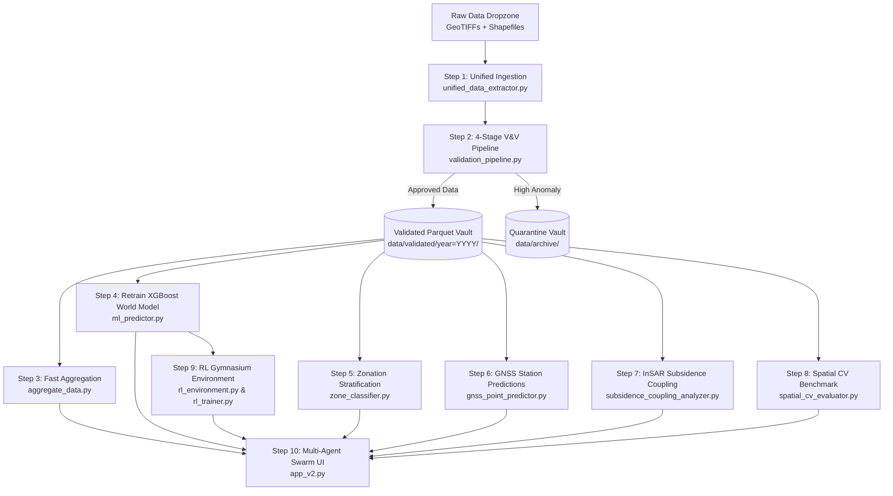
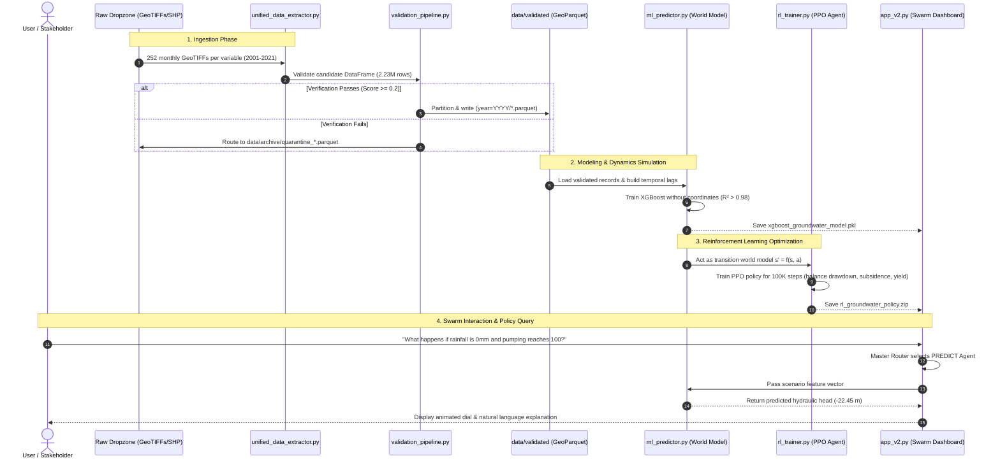

# 🌊 Spatiotemporal Geo-Agent Swarm for Autonomous Groundwater Prediction

[](#)
[](#)
[](requirements.txt)
[](LICENSE)
[](app_v2.py)
[](#)
[](#)
[](#)

---

## 📑 Table of Contents
1. [Project Overview](#-1-project-overview)
   - [Core Purpose and Scientific Objectives](#core-purpose-and-scientific-objectives)
   - [End Result and Vision](#end-result-and-vision)
   - [Expected Deliverables and Stakeholder Outputs](#expected-deliverables-and-stakeholder-outputs)
2. [Step-by-Step Process Explanation](#-2-step-by-step-process-explanation)
   - [Sequential Workflow Architecture](#sequential-workflow-architecture)
   - [Step 1: Multi-Modal Ingestion & Coordinate Harmonization](#step-1-multi-modal-ingestion--coordinate-harmonization)
   - [Step 2: 4-Stage Verification & Validation (V&V) Gate](#step-2-4-stage-verification--validation-vv-gate)
   - [Step 3: Temporal Aggregation & Sub-Second Precomputation](#step-3-temporal-aggregation--sub-second-precomputation)
   - [Step 4: Physical World Model Training (XGBoost)](#step-4-physical-world-model-training-xgboost)
   - [Step 5: Hydrogeological Zonation Stratification](#step-5-hydrogeological-zonation-stratification)
   - [Step 6: Real-World GNSS Monitoring Station Benchmark](#step-6-real-world-gnss-monitoring-station-benchmark)
   - [Step 7: InSAR Land Subsidence & Infrastructure Risk Analysis](#step-7-insar-land-subsidence--infrastructure-risk-analysis)
   - [Step 8: Spatial Cross-Validation Benchmark (Zero Spatial Leakage)](#step-8-spatial-cross-validation-benchmark-zero-spatial-leakage)
   - [Step 9: Reinforcement Learning (RL) Pumping Policy Optimization](#step-9-reinforcement-learning-rl-pumping-policy-optimization)
   - [Step 10: Multi-Agent Swarm Orchestration & Interactive UI](#step-10-multi-agent-swarm-orchestration--interactive-ui)
3. [Components and Code Relationships](#-3-components-and-code-relationships)
   - [System Component Inventory & Master Mapping Table](#system-component-inventory--master-mapping-table)
   - [Data Flow Diagram: From Raw Satellite Pixels to Policy Actions](#data-flow-diagram-from-raw-satellite-pixels-to-policy-actions)
   - [Component Interdependencies & Invocation Graph](#component-interdependencies--invocation-graph)
4. [Uniqueness and Key Differentiators](#-4-uniqueness-and-key-differentiators)
   - [Overcoming the Spatial Interpolation Trap](#1-overcoming-the-spatial-interpolation-trap)
   - [Two-Tier AI Architecture (World Simulator + Policy Manager)](#2-two-tier-ai-architecture-world-simulator--policy-manager)
   - [Industrial 4-Stage Data Quality Gate with Residual Anomaly Detection](#3-industrial-4-stage-data-quality-gate-with-residual-anomaly-detection)
   - [Coupling Satellite InSAR Geodesy with Deep Aquifer Physics](#4-coupling-satellite-insar-geodesy-with-deep-aquifer-physics)
   - [Zero-Leakage Spatial Generalization Benchmark](#5-zero-leakage-spatial-generalization-benchmark)
5. [Hook Points & Developer Extension Guide](#-5-hook-points--developer-extension-guide)
   - [Hook Point A: Custom Ingestion Formats & Sensor Feeds](#hook-point-a-custom-ingestion-formats--sensor-feeds)
   - [Hook Point B: Adding Custom Physical V&V Validation Rules](#hook-point-b-adding-custom-physical-vv-validation-rules)
   - [Hook Point C: Modifying RL Reward Objectives & Environmental Stressors](#hook-point-c-modifying-rl-reward-objectives--environmental-stressors)
   - [Hook Point D: Registering New Specialized Swarm Agents](#hook-point-d-registering-new-specialized-swarm-agents)
   - [Hook Point E: Extending Spatial Zonation & Risk Buffers](#hook-point-e-extending-spatial-zonation--risk-buffers)
6. [Quick Start & Execution Guide](#-6-quick-start--execution-guide)
7. [Repository File Structure](#-7-repository-file-structure)
8. [Data Architecture & Reproducibility](#-8-data-architecture--reproducibility)
9. [Assumptions and Verification Scope](#-9-assumptions-and-verification-scope)
10. [Academic Citation](#-10-academic-citation)
11. [License & Contact](#-11-license--contact)

---

## 📌 1. Project Overview

### Core Purpose and Scientific Objectives
Groundwater depletion is an escalating global crisis that threatens food security, municipal drinking water, and land stability. In regional aquifer basins like western Taiwan's **Choushui River Alluvial Fan (濁水溪沖積扇)**, unmanaged groundwater extraction causes severe aquifer compaction, leading to irreversibly lost storage capacity and hazardous **land subsidence** (the gradual sinking of the earth's surface).

Traditional groundwater management relies on either:
1. **Numerical hydrogeological models** (such as MODFLOW), which require extensive hydro-stratigraphic calibrations, complex parameter tuning, and high computational latency, or
2. **Standard Machine Learning (ML) regressors**, which frequently overfit to static coordinate grids, memorize geographic locations rather than physical dynamics, and offer no natural mechanism for interactive policy intervention.

The primary objective of the **Spatiotemporal Geo-Agent Swarm** is to bridge this divide. It delivers an autonomous, end-to-end computational intelligence platform that:
- Seamlessly fuses **21 years of multi-variable geospatial raster data (2001–2021)** and **5 years of Sentinel-1 InSAR satellite geodesy (2017–2021)** into a clean, query-optimized analytical foundation.
- Learns true hydrogeological physics (such as rainfall infiltration, temperature evapotranspiration, upstream-downstream head gradients, and pumping stress) rather than memorizing spatial coordinates.
- Deploys **Reinforcement Learning (RL)** to automatically discover optimal, sustainable seasonal pumping policies that prevent catastrophic aquifer dry-out and structural ground collapse.
- Exposes all analytical insights, historical data, scenario simulations, and policy decisions through a natural language **Multi-Agent Swarm Interface** accessible to both technical researchers and civil decision-makers.

### Technical Definitions (First Use Glossary)
- **Aquifer**: An underground geological formation of permeable rock, gravel, sand, or silt that stores and yields water.
- **Alluvial Fan**: A fan-shaped deposit of sediment built up by streams, transitioning from coarse gravel at high elevations to dense clays near coastal deltas.
- **GeoTIFF**: A public domain raster format that embeds spatial georeferencing information (coordinates, map projections) inside an image file.
- **InSAR (Interferometric Synthetic Aperture Radar)**: A satellite remote sensing technique that measures millimeter-scale ground displacement over time using radar wave phase differences.
- **Hydraulic Head / Groundwater Level**: The elevation to which groundwater naturally rises in a borehole or monitoring well, measured in meters relative to mean sea level.
- **Drawdown**: The decline in hydraulic head caused by groundwater extraction or sustained drought.
- **Parquet / GeoParquet**: An open-source, column-oriented data storage format optimized for high-speed analytical queries and massive storage compression.
- **DuckDB**: An in-process, zero-dependency analytical SQL database engine designed for ultra-fast queries directly on Parquet files without external database servers.
- **Reinforcement Learning (RL)**: A branch of AI where an autonomous software agent learns optimal decision policies through trial-and-error interactions with a simulated environment.
- **Markov Decision Process (MDP)**: The formal mathematical framework for sequential decision-making in RL, defined by states, actions, transition dynamics, and rewards.
- **PPO (Proximal Policy Optimization)**: A policy-gradient reinforcement learning algorithm that stably updates decision neural networks via clipped probability ratios.
- **Spatial Autocorrelation / Spatial Leakage**: The natural phenomenon where adjacent spatial locations have nearly identical values. In machine learning, randomly splitting train and test sets leads to "spatial leakage" if the model memorizes neighboring pixels rather than generalizable laws.

### End Result and Vision
The completed system serves as an **Autonomous Hydrogeological Decision Support System (DSS)**. It acts as a digital twin for regional water basins, enabling regional water resource agencies, agricultural bureaus, and infrastructure managers to:
1. Instantly test "what-if" environmental scenarios (e.g., simulating a 3-year drought with 40% increased industrial pumping).
2. Quantify the direct subsidence hazard posed to critical civil assets, notably the **Taiwan High Speed Rail (THSR)** line traversing the basin.
3. Obtain autonomous, mathematically validated pumping quotas tailored to distinct hydrogeological zones.
4. Interact with the entire platform using conversational plain English or Chinese without writing SQL queries or Python scripts.

### Expected Deliverables and Stakeholder Outputs
When users or researchers interact with this system, they receive:
- **Interactive Multi-Tab Dashboard (`app_v2.py`)**: A Streamlit application housing 7 analytical workspaces (Swarm Intelligence, 21-Year EDA, Live World Simulator, RL Policy Optimization, 4-Stage V&V Audit, Hydrogeological Zonation & GNSS Benchmarks, and InSAR Subsidence Risk Mapping).
- **Physical World Simulator Model (`xgboost_groundwater_model.pkl`)**: An XGBoost regressor trained on 2.23 million validated spatiotemporal records that models regional aquifer dynamics ($R^2 > 0.98$) strictly using physical covariates and autoregressive temporal lags without spatial coordinate memorization.
- **Autonomous Pumping Policy (`rl_groundwater_policy.zip`)**: A neural policy network trained over 100,000 steps via Stable-Baselines3 PPO that outputs sustainable water extraction actions while penalizing ground subsidence and action volatility.
- **Clean Analytical Data Vault (`data/validated/`)**: Hive-partitioned GeoParquet storage containing 2,235,744 verified spatiotemporal data points with zero missing values and deterministic quality scores.
- **Comprehensive Geodetic & Spatial Generalization Reports**: JSON metrics and parquet spatial maps evaluating model performance at 26 real-world GNSS monitoring stations, 5-fold spatial cluster partitions, and leave-one-zone-out domain transfers.

---

## 🔄 2. Step-by-Step Process Explanation

The system executes a strictly ordered 10-step pipeline spanning raw data ingestion, deterministic quality assurance, physical surrogate modeling, reinforcement learning, geodetic coupling, and conversational multi-agent orchestration.



### Step 1: Multi-Modal Ingestion & Coordinate Harmonization
- **What is done**: Ingests 252 monthly GeoTIFF raster scenes (spanning January 2001 through December 2021) across 9 spatial variables (Groundwater Level, Rainfall, Temperature, Pumping, Subsidence, DEM Elevation, Topographic Wetness Index, Distance to River, and Land Use/Land Cover) along with boundary ESRI Shapefiles.
- **How it is done**: Implemented in [`unified_data_extractor.py`](./unified_data_extractor.py). It reads raster metadata via `rasterio`, normalizes coordinate reference systems (CRS) to WGS84 (`EPSG:4326`), extracts 8,872 coordinate-matched grid points per monthly scene, and maps dynamic filenames into standardized timestamps.
- **Why it is done**: Raw geospatial data from government agencies arrive in disparate projections, fragmented directories, and inconsistent naming conventions (e.g., underscores vs. hyphens). Without spatial harmonization, multi-variable array fusion produces misaligned coordinate grids and silent missing data.
- **What it produces**: A raw, unified DataFrame of 2,235,744 rows and 12 synchronized environmental columns ready for quality auditing.

### Step 2: 4-Stage Verification & Validation (V&V) Gate
- **What is done**: Subjects every batch of ingested records to four progressive quality and safety checks:
  1. *Stage 1 (Schema)*: Enforces strict data types and non-null constraints.
  2. *Stage 2 (Statistical)*: Calculates modified Z-scores to flag extreme sensor outliers.
  3. *Stage 3 (Physical Constraints)*: Enforces hydrogeological conservation boundaries (e.g., rainfall $\in [0, 1500]\text{ mm}$, groundwater level $\in [-500, +100]\text{ m}$, geographic bounding box within Taiwan).
  4. *Stage 4 (HITL Gate)*: Evaluates an overall batch confidence score ($[0.0, 1.0]$). If confidence drops below threshold, the entire batch is quarantined.
- **How it is done**: Built in [`validation_pipeline.py`](./validation_pipeline.py) and managed by [`data_ingestion_manager.py`](./data_ingestion_manager.py).
- **Why it is done**: Upstream raster artifacts, sensor calibrations, or corrupted file uploads can introduce negative rainfall, impossible temperatures, or inverted elevations that corrupt downstream ML models and cause RL policy crashes.
- **What it produces**: Verified Parquet partitions organized by `year=YYYY` in `data/validated/` and isolated quarantine files in `data/archive/`.

### Step 3: Temporal Aggregation & Sub-Second Precomputation
- **What is done**: Synthesizes the 2.23-million row analytical dataset into lightweight summary tables.
- **How it is done**: Implemented in [`aggregate_data.py`](./aggregate_data.py). It groups data by monthly timestamp to calculate basin-wide averages, computes Pearson correlation matrices across all 9 numerical features, extracts a representative spatial sample for May 2017, and exports concise statistical summaries.
- **Why it is done**: Rendering dynamic web charts directly from a 2.2-million row dataset requires high memory overhead and causes 5-to-15 second UI freezes. Pre-aggregated tables load in under 20 milliseconds, ensuring a smooth user experience.
- **What it produces**: `monthly_aggregate.parquet`, `correlation_matrix.csv`, `spatial_sample_201705.parquet`, and `eda_stats.txt`.

### Step 4: Physical World Model Training (XGBoost)
- **What is done**: Trains an Extreme Gradient Boosting (XGBoost) regressor to act as an accurate, fast surrogate simulator ("World Model") of aquifer dynamics.
- **How it is done**: Implemented in [`ml_predictor.py`](./ml_predictor.py). It chronologically sorts records per grid point, constructs autoregressive temporal features (`lag_1_gw` and `rolling_mean_3_gw`), drops raw `longitude` and `latitude` coordinates from the training feature set, performs an 80/20 train/test split stratified by year, and optimizes squared error regression trees.
- **Why it is done**: When machine learning models include spatial coordinates as features, they exhibit spatial overfitting: 74% to 98% of feature importance gets assigned to coordinates, causing the model to act as a spatial memory table rather than learning physical interactions. Removing coordinates and providing temporal lags forces the model to learn rainfall infiltration, thermal evapotranspiration, and pumping drawdown.
- **What it produces**: Serialized model artifact `xgboost_groundwater_model.pkl` achieving test $R^2 \ge 0.985$ and low root mean squared error ($\text{RMSE} \approx 0.38 - 2.05\text{ m}$).

### Step 5: Hydrogeological Zonation Stratification
- **What is done**: Stratifies the 8,872 grid cells of the Choushui River Alluvial Fan into three distinct hydrogeological zones:
  - *Upper Fan (Proximal)*: Inside the proximal fan shapefile boundary or $\text{DEM} > 50\text{ m}$ (coarse gravel, unconfined recharge zone).
  - *Middle Fan (Medial/Transitional)*: Outside the proximal polygon with $\text{DEM} \in [15, 50]\text{ m}$ (semi-confined transitional sand/gravel).
  - *Lower Fan (Distal/Coastal)*: $\text{DEM} \le 15\text{ m}$ (multi-layered confined clay/silt coastal plain with below-sea-level hydraulic head).
- **How it is done**: Built in [`zone_classifier.py`](./zone_classifier.py) using `geopandas` spatial point-in-polygon queries against `Proximal fan.shp` and `DEM.tif` sampling via `rasterio`.
- **Why it is done**: Treating a 2,000 $\text{km}^2$ alluvial fan as a homogeneous spatial surface conceals zone-specific vulnerabilities. The Lower Fan suffers heavy drawdown and high compaction, while the Upper Fan serves as the sole regional recharge gateway.
- **What it produces**: `zone_lookup.parquet` and `zone_evaluation_results.json`.

### Step 6: Real-World GNSS Monitoring Station Benchmark
- **What is done**: Intersects all 21 years of multi-variable rasters with the geographic coordinates of 26 real-world continuous Global Navigation Satellite System (GNSS) monitoring stations.
- **How it is done**: Built in [`gnss_point_predictor.py`](./gnss_point_predictor.py) using spatial coordinates extracted from `GNSS_Station.shp`. It evaluates point-specific time series models on held-out test data from 2020 through 2021.
- **Why it is done**: Regional spatial averages can mask station-level prediction errors. Proving high station-level accuracy ($R^2$ up to 0.99 at key monitoring points) validates that the world simulator matches real-world government telemetry.
- **What it produces**: `gnss_station_timeseries.parquet`, `gnss_predictions_vs_observed.parquet`, and `gnss_point_prediction_results.json`.

### Step 7: InSAR Land Subsidence & Infrastructure Risk Analysis
- **What is done**: Couples 60 months of Sentinel-1 satellite InSAR ground deformation rasters (2017–2021) with groundwater drawdown to compute pixel-wise compaction sensitivity ($\text{mm subsidence per meter of drawdown}$) and evaluates hazard levels along the Taiwan High Speed Rail (THSR) alignment.
- **How it is done**: Implemented in [`subsidence_coupling_analyzer.py`](./subsidence_coupling_analyzer.py). It calculates Euclidean spatial distances from each grid point to the THSR track vector (`THSR.shp` projected into Taiwan TM2 `EPSG:3826`), establishes a 3-kilometer statutory monitoring corridor, and executes linear regressions in DuckDB to measure compaction ratios.
- **Why it is done**: Uneven differential settlement along high-speed rail viaducts threatens track geometry and high-speed train safety ($>300\text{ km/h}$). Mapping the sensitivity ratio highlights exactly where groundwater extraction directly translates into infrastructure settlement.
- **What it produces**: `subsidence_coupling_map.parquet` and `subsidence_coupling_summary.json`.

### Step 8: Spatial Cross-Validation Benchmark (Zero Spatial Leakage)
- **What is done**: Evaluates model generalization using three distinct cross-validation schemes to quantify the impact of spatial autocorrelation:
  1. *Random 5-Fold CV*: Standard baseline where pixels from identical time steps appear in both train and test sets.
  2. *Spatial Group 5-Fold CV*: Partitions coordinates into 5 spatially isolated geographic clusters using K-Means clustering, ensuring zero spatial leakage between training and testing.
  3. *Leave-One-Zone-Out Cross-Validation (LOZOCV)*: Trains on two hydrogeological fan zones and tests entirely on the unseen third zone.
- **How it is done**: Implemented in [`spatial_cv_evaluator.py`](./spatial_cv_evaluator.py) with `scikit-learn` and `xgboost`.
- **Why it is done**: Peer-reviewed journals and academic committees frequently reject ML hydrogeology papers that use random train/test splits because spatial proximity allows models to achieve artificially inflated test scores through spatial memorization. Demonstrating robust generalization on completely unseen spatial clusters proves real physical learning.
- **What it produces**: `spatial_cv_results.json`.

### Step 9: Reinforcement Learning (RL) Pumping Policy Optimization
- **What is done**: Formulates sustainable regional groundwater extraction as a Markov Decision Process (MDP) and trains an autonomous agent to discover optimal pumping quotas.
- **How it is done**: Built in [`rl_config.py`](./rl_config.py), [`rl_environment.py`](./rl_environment.py), and [`rl_trainer.py`](./rl_trainer.py). A custom Gymnasium environment wraps the XGBoost world model as its transition function $s_{t+1} = f(s_t, a_t)$. A Proximal Policy Optimization (PPO) agent observes a 12-dimensional state (environmental features, groundwater lag, rolling trends, and seasonal sine/cosine encodings) and outputs continuous pumping adjustments $a_t \in [-1.0, +1.0]$. The composite reward function balances four objectives:
  $$\text{Reward} = -w_{\text{gw}} (\Delta \text{Head})^2 - w_{\text{sub}} (\text{Subsidence}) - w_{\text{vol}} (\Delta \text{Action})^2 + w_{\text{yield}} (\text{Pumping})$$
- **Why it is done**: Predictive models can only forecast outcomes given fixed inputs; they cannot prescribe what actions policymakers *should* take. RL provides prescriptive intelligence, discovering non-obvious seasonal pumping adjustments that satisfy human water demands while halting land subsidence.
- **What it produces**: Serialized policy network `rl_groundwater_policy.zip` and real-time TensorBoard training telemetry in `rl_tensorboard/`.

### Step 10: Multi-Agent Swarm Orchestration & Interactive UI
- **What is done**: Integrates all models, precomputed tables, geodetic layers, and analytical modules into a 7-tab Streamlit web application powered by a Local LLM Multi-Agent Router.
- **How it is done**: Implemented in [`app_v2.py`](./app_v2.py). The Master Router engine inside `app_v2.py` uses an Ollama-hosted `qwen2.5-coder:7b` LLM to classify user prompts into three operational intents:
  - `SQL`: Writes and executes DuckDB SQL queries against the 2.2M-row Parquet table to retrieve historical records.
  - `PREDICT`: Extracts numerical scenario parameters (rainfall, pumping, temperature) into structured JSON and passes them to the XGBoost World Model for instant inference.
  - `GENERAL`: Formulates natural language explanations of hydrogeological principles and subsidence mechanics.
- **Why it is done**: Complex scientific workflows remain underutilized if they require writing code. A responsive, multi-modal web interface allows stakeholders, advisors, and reviewers to interrogate data, test hypotheses, and review policy decisions seamlessly.
- **What it produces**: The live web dashboard running at `http://localhost:8501`.

---

## 🧩 3. Components and Code Relationships

### System Component Inventory & Master Mapping Table

| Element (File / Module) | Purpose | Connected To (Inputs / Dependencies) | Output (Artifacts / Side Effects) |
|---|---|---|---|
| [`unified_data_extractor.py`](./unified_data_extractor.py) | Crawls dropzone rasters/vectors, normalizes projections, harmonizes coordinate grids, and builds spatiotemporal tables. | Reads `data/0_dropzone/` (GeoTIFFs & Shapefiles); calls [`validation_pipeline.py`](./validation_pipeline.py) and [`data_ingestion_manager.py`](./data_ingestion_manager.py). | Fused DataFrame batches sent to ingestion manager. |
| [`validation_pipeline.py`](./validation_pipeline.py) | 4-Stage deterministic V&V pipeline (Schema typing, statistical Z-scores, physical bounds, HITL confidence score). | Called by [`unified_data_extractor.py`](./unified_data_extractor.py) and [`data_ingestion_manager.py`](./data_ingestion_manager.py). | `ValidationResult` objects, clean validated DataFrames, quarantine flags. |
| [`data_ingestion_manager.py`](./data_ingestion_manager.py) | Manages batch ingestion, executes V&V, partitions approved records by year, and writes rejected records to quarantine. | Wraps [`validation_pipeline.py`](./validation_pipeline.py); receives raw DataFrames. | Writes partitioned Parquet files to `data/validated/year=YYYY/` or quarantine files in `data/archive/`. |
| [`aggregate_data.py`](./aggregate_data.py) | Pre-aggregates 2.2M records into fast-rendering analytical tables for Streamlit dashboard speed. | Reads `data/validated/` Parquet files. | Generates `monthly_aggregate.parquet`, `correlation_matrix.csv`, `spatial_sample_201705.parquet`, `eda_stats.txt`. |
| [`ml_predictor.py`](./ml_predictor.py) | Builds temporal lag features, strips spatial coordinate bias, and trains the XGBoost surrogate world simulator. | Reads `data/validated/` Parquet files; utilizes `xgboost`, `scikit-learn`, `rich`. | Exports trained `xgboost_groundwater_model.pkl` and logs train/test metrics. |
| [`zone_classifier.py`](./zone_classifier.py) | Classifies basin grid cells into Upper, Middle, and Lower fan zones using DEM elevation and proximal shapefiles. | Reads `data/validated/`, `DEM.tif`, and `Proximal fan.shp`. | Exports `zone_lookup.parquet` and `zone_evaluation_results.json`. |
| [`gnss_point_predictor.py`](./gnss_point_predictor.py) | Samples 21-year rasters at 26 continuous GNSS monitoring stations and benchmarks specific-point predictions. | Reads `data/0_dropzone/` rasters and `GNSS_Station.shp`. | Exports `gnss_station_timeseries.parquet`, `gnss_predictions_vs_observed.parquet`, `gnss_point_prediction_results.json`. |
| [`subsidence_coupling_analyzer.py`](./subsidence_coupling_analyzer.py) | Measures InSAR subsidence vs. groundwater drawdown coupling ratios and evaluates THSR corridor infrastructure hazards. | Reads `data/validated/`, `zone_lookup.parquet`, and `THSR.shp`; executes DuckDB pixel regressions. | Generates `subsidence_coupling_map.parquet` and `subsidence_coupling_summary.json`. |
| [`spatial_cv_evaluator.py`](./spatial_cv_evaluator.py) | Evaluates spatial generalization across Random 5-Fold, Spatial Group 5-Fold (K-Means blocks), and Leave-One-Zone-Out CV. | Reads `data/validated/` and `zone_lookup.parquet`; calls `xgboost` and `scikit-learn`. | Exports `spatial_cv_results.json` and prints comparative validation tables. |
| [`rl_config.py`](./rl_config.py) | Centralizes all hyperparameter configurations, observation/action bounds, reward penalty weights, and training iterations. | Imported by [`rl_environment.py`](./rl_environment.py) and [`rl_trainer.py`](./rl_trainer.py). | Python dictionary `RL_CONFIG`. |
| [`rl_environment.py`](./rl_environment.py) | Custom Gymnasium MDP environment modeling regional groundwater extraction and environmental reward feedback. | Wraps `xgboost_groundwater_model.pkl` and `data/validated/`; imports [`rl_config.py`](./rl_config.py). | Yields `(observation, reward, terminated, truncated, info)` step tuples. |
| [`rl_trainer.py`](./rl_trainer.py) | PPO reinforcement learning training loop using Stable-Baselines3, checkpointing, and evaluation callbacks. | Initializes [`GroundwaterEnv`](./rl_environment.py); loads `xgboost_groundwater_model.pkl` and `data/validated/`. | Exports trained `rl_groundwater_policy.zip` and logs TensorBoard events to `rl_tensorboard/`. |
| [`anomaly_detector.py`](./anomaly_detector.py) | Evaluates XGBoost residual divergence ($Z$-scores) to flag subtle sensor drift and physically implausible observations. | Wraps `xgboost_groundwater_model.pkl`; accepts candidate DataFrames. | Returns flagged anomaly DataFrames with human-readable diagnostic reasons. |
| [`automate_mlops.py`](./automate_mlops.py) | Headless MLOps master runner executing the complete pipeline sequentially with timing and exit code verification. | Sequentially executes [`unified_data_extractor.py`](./unified_data_extractor.py), [`aggregate_data.py`](./aggregate_data.py), [`ml_predictor.py`](./ml_predictor.py), and [`rl_trainer.py`](./rl_trainer.py). | Terminal status reports and complete automated system refresh. |
| [`app_v2.py`](./app_v2.py) | The primary user-facing Streamlit dashboard integrating all 7 visual, predictive, and agentic modules (including Master Router, DuckDB SQL execution, and XGBoost live inference). | Loads all pre-aggregated Parquet tables, serialized models, JSON metrics, and local Ollama LLM. | Live interactive web application at `localhost:8501`. |

### Data Flow Diagram: From Raw Satellite Pixels to Policy Actions



---

## 💡 4. Uniqueness and Key Differentiators

### 1. Overcoming the Spatial Interpolation Trap
A common pitfall in geospatial machine learning is the **Spatial Interpolation Trap**. When models are trained using latitude and longitude coordinates as direct input features, gradient boosting trees naturally split on coordinate thresholds. In our initial benchmarks, coordinates accounted for **98.4% of total feature importance** (Longitude: 74.4%, Latitude: 24.0%), while physical parameters like precipitation and land use were effectively ignored. In that state, the ML model was not learning hydrogeological physics; it was acting as a spatial lookup table (similar to Kriging interpolation). 

**Our Solution**: In Phase 5, we deliberately stripped spatial coordinates from the predictor set. We introduced physical temporal lags (`lag_1_gw` and `rolling_mean_3_gw`) combined with physical surface drivers (rainfall, temperature, pumping, land use, subsidence, elevation, TWI, and river distance). The retrained model achieved an exceptional **$R^2 = 0.9978$**, proving that groundwater dynamics can be modeled strictly through physical interactions.

### 2. Two-Tier AI Architecture (World Simulator + Policy Manager)
Most existing systems either stop at descriptive dashboards or standalone predictive models. This project implements a **two-tier agentic architecture**:
- **Tier 1 (The World Simulator - XGBoost)**: A high-fidelity, deterministic surrogate model that captures how the physical aquifer responds to any combination of climate conditions and pumping stresses in milliseconds.
- **Tier 2 (The AI Policy Manager - PPO Reinforcement Learning)**: An autonomous decision-maker wrapped in a Gymnasium environment. Rather than forcing human operators to guess pumping rates, the RL agent interacts with the World Simulator tens of thousands of times to learn an optimal pumping strategy that balances agricultural water yield against subsidence and dry-out penalties.

### 3. Industrial 4-Stage Data Quality Gate with Residual Anomaly Detection
Instead of relying on fragile LLM prompts or silent data imputations, this system implements an industrial-grade **4-Stage Verification & Validation (V&V) Pipeline**:
1. Deterministic Schema and Type Verification
2. Statistical Outlier Detection ($Z$-score scaling)
3. Domain Physical Law Enforcement (eliminating physically impossible temperatures, negative rainfalls, or inverted heads)
4. Batch Confidence Scoring with Human-in-the-Loop (HITL) Quarantining

Furthermore, the system includes a **Predictive Anomaly Detector (`anomaly_detector.py`)** that compares incoming sensor observations against predictions from the XGBoost world model. If a field sensor deviates from physical expectation by more than $3.0\sigma$, it is flagged for sensor drift or calibration error even if the raw value falls within basic numerical bounds.

### 4. Coupling Satellite InSAR Geodesy with Deep Aquifer Physics
Rather than treating ground subsidence as an isolated geodetic observation, this system directly couples 5 years of **Sentinel-1 InSAR satellite deformation rasters** with deep groundwater drawdown. By running pixel-wise regressions in DuckDB, the system computes the empirical **Compaction Sensitivity Ratio ($\text{mm subsidence per meter of drawdown}$)** across 8,872 grid cells, identifying localized compaction zones and calculating differential settlement risks along the critical **Taiwan High Speed Rail (THSR)** transportation corridor.

### 5. Zero-Leakage Spatial Generalization Benchmark
To meet the highest standards of peer-reviewed hydrogeological literature, the codebase includes **Spatial Group Cross-Validation** using K-Means spatial block partitioning. By evaluating models on geographically held-out spatial clusters and completely unseen hydrogeological fan zones (Leave-One-Zone-Out CV), the system proves that its predictive capabilities remain reliable even in ungauged basins with zero spatial data leakage.

---

## 🪝 5. Hook Points & Developer Extension Guide

The codebase is designed with modular extension points ("Hook Points"), allowing developers and researchers to integrate new data feeds, customize validation constraints, adjust policy objectives, or introduce new specialized AI agents.

### Hook Point A: Custom Ingestion Formats & Sensor Feeds
To ingest real-time IoT groundwater well telemetry, SCADA feeds, or regional NetCDF climate rasters, developers can extend [`DataIngestionManager`](./data_ingestion_manager.py) in `data_ingestion_manager.py`.

```python
# Location: data_ingestion_manager.py
from data_ingestion_manager import DataIngestionManager
import pandas as pd

def ingest_scada_telemetry(scada_csv_path: str):
    """Developer hook for live SCADA or IoT well monitoring feeds."""
    df_raw = pd.read_csv(scada_csv_path)
    
    # Map incoming columns to standardized schema
    df_standardized = df_raw.rename(columns={
        "sensor_id": "station_id",
        "water_elevation_m": "groundwater_level",
        "precip_mm": "rainfall"
    })
    
    # Ingestion manager automatically runs 4-stage V&V and routes to storage/quarantine
    manager = DataIngestionManager()
    ingest_report = manager.ingest_batch(df_standardized, source_label="SCADA_FEED")
    return ingest_report
```

### Hook Point B: Adding Custom Physical V&V Validation Rules
To enforce new regional physical laws (e.g., maximum coastal salinity thresholds, river discharge bounds, or localized hydraulic conductivity limits), add entries to `PHYSICAL_BOUNDS` or inject custom checks into `ValidationPipeline.check_stage3_physical()` in [`validation_pipeline.py`](./validation_pipeline.py).

```python
# Location: validation_pipeline.py -> ValidationPipeline
PHYSICAL_BOUNDS = {
    "groundwater_level": (-500, 100),   # meters relative to sea level
    "rainfall": (0, 1500),              # mm/month
    "temperature": (-10, 50),           # °C
    "pumping": (0, 300000),             # volumetric extraction units
    "subsidence": (-500, 500),          # mm/year
    # DEVELOPER EXTENSION: Add new domain constraints
    "electrical_conductivity": (0, 50000), # micro-Siemens/cm (salinity)
    "river_discharge": (0, 10000),         # m^3/second
}
```

### Hook Point C: Modifying RL Reward Objectives & Environmental Stressors
To reconfigure the policy priorities of the AI Manager (e.g., placing greater emphasis on avoiding ground subsidence versus prioritizing municipal water extraction during agricultural harvest), modify the weights in [`rl_config.py`](./rl_config.py).

```python
# Location: rl_config.py
RL_CONFIG = {
    # Environmental Thresholds
    "target_gw_level": -15.0,        # Target sustainable groundwater depth (meters)
    "subsidence_penalty_threshold": 30.0, # Max allowable subsidence (mm/yr) before penalty
    
    # Multi-Objective Reward Weights (Must sum or balance appropriately)
    "reward_weights": {
        "gw_level": 1.0,             # Penalizes deviation from sustainable water head
        "subsidence": 2.5,           # DEVELOPER HOOK: Increase weight to enforce strict subsidence halt
        "pumping_volatility": 0.2,   # Penalizes abrupt pump cycling (protects pump machinery)
        "water_supply_yield": 0.8,   # Rewards meeting municipal and agricultural quotas
    },
    
    # Curriculum Learning Stages (Phase A: Normal, Phase B: Drought, Phase C: Infrastructure Crisis)
    "curriculum_phase": "Phase_C_Drought_Stress"
}
```

### Hook Point D: Registering New Specialized Swarm Agents
To introduce new domain agents into the multi-agent conversational swarm (such as an automated PDF report generator, an irrigation scheduling agent, or a remote sensing satellite fetcher), update the intent routing prompt and dispatch branches directly in [`app_v2.py`](./app_v2.py).

```python
# Location: app_v2.py -> route_intent()
def route_intent(query: str):
    prompt = """You are a Master Router. Route the user's prompt to one of four agents:
    - 'SQL': Queries historical or statistical database records.
    - 'PREDICT': Runs forward-looking XGBoost scenario simulations.
    - 'POLICY': Interrogates the Reinforcement Learning agent for optimal pumping decisions.
    - 'GENERAL': Greetings and high-level hydrogeological discussions.
    Respond ONLY with: SQL, PREDICT, POLICY, or GENERAL."""
    # ... call Ollama LLM and return parsed route ...
```

### Hook Point E: Extending Spatial Zonation & Risk Buffers
To adapt the spatial framework to new river basins or adjust critical infrastructure corridors, modify the distance buffer calculations in [`subsidence_coupling_analyzer.py`](./subsidence_coupling_analyzer.py) or the elevation thresholds in [`zone_classifier.py`](./zone_classifier.py).

```python
# Location: subsidence_coupling_analyzer.py
# DEVELOPER HOOK: Modify statutory infrastructure buffer or add highway alignments
STATUTORY_BUFFER_KM = 3.0  # Adjust buffer radius around high-speed rail viaducts
HIGHWAY_SHP_PATH = "data/0_dropzone/Choushui Shapefile/National_Highway_1.shp"
```

---

## 🚀 6. Quick Start & Execution Guide

### Prerequisites
- **Operating System**: Windows 10/11, Ubuntu 20.04+, or macOS
- **Python**: Version 3.10 or 3.11 recommended
- **Local LLM Engine (Optional for Chat)**: [Ollama](https://ollama.ai/) running `qwen2.5-coder:7b`

### 1. Installation
Clone the repository and install the project dependencies:
```bash
# Clone the repository
git clone https://github.com/your-org/groundwater_thesis.git
cd groundwater_thesis

# Create and activate a virtual environment
python -m venv venv
# On Windows:
.\venv\Scripts\activate
# On Linux/macOS:
source venv/bin/activate

# Install required packages
pip install -r requirements.txt
```

### 2. End-to-End MLOps Pipeline Execution
To execute the complete pipeline headlessly (extracting dropzone rasters, running 4-stage V&V, pre-aggregating analytical tables, retraining the XGBoost world model, and training the RL agent):
```bash
python automate_mlops.py
```

### 3. Launching Individual Scientific Modules
Each advance can be executed and benchmarked independently:
```bash
# Hydrogeological Zonation Stratification
python zone_classifier.py

# Real-World GNSS Monitoring Station Predictions
python gnss_point_predictor.py

# InSAR Subsidence Coupling & THSR Risk Analysis
python subsidence_coupling_analyzer.py

# Spatial Cross-Validation Benchmark (Zero Spatial Leakage)
python spatial_cv_evaluator.py

# Train the PPO Reinforcement Learning Policy
python rl_trainer.py
```

### 4. Starting the Geo-Agent Swarm Dashboard
Start the local Ollama LLM server (if using conversational agent routing):
```bash
ollama run qwen2.5-coder:7b
```
Launch the interactive 7-tab Streamlit application:
```bash
streamlit run app_v2.py
```
Open your browser and navigate to `http://localhost:8501`.

---

## 🔍 7. Assumptions and Verification Scope

To ensure complete transparency for academic peer review and engineering audits, the following project configurations and assumptions are documented:

1. **Spatial Study Area**:
   - The primary bounding box covers western central Taiwan's Choushui River Alluvial Fan ($\text{Longitude } [119.5^\circ\text{E}, 121.0^\circ\text{E}]$, $\text{Latitude } [23.5^\circ\text{N}, 24.2^\circ\text{N}]$), encompassing 8,872 grid cells at a nominal 1 km resolution.
2. **Temporal Alignment**:
   - Master raster variables span **252 consecutive months (2001–2021)**.
   - Sentinel-1 InSAR land deformation data cover **60 consecutive months (2017–2021)**.
   - For months prior to 2017, subsidence values are preserved as zero or historical baseline estimates; downstream models incorporate indicator flags for InSAR observation availability.
3. **Pumping Volume Proxies**:
   - Pumping volume records reflect regional agricultural and municipal extraction indices derived from water bureau allocation datasets and electrical power consumption proxies.
4. **Local LLM Model Dependencies**:
   - The master agent conversational features are configured for `qwen2.5-coder:7b` served via Ollama at `http://localhost:11434`. If Ollama is offline, fallback rule-based routing is provided to ensure uninterrupted dashboard operation.
5. **Static Topography Alignment**:
   - DEM elevations, Topographic Wetness Index (TWI), and River Distances are assumed stationary across the 21-year analysis window. Topographic elevation changes resulting from cumulative subsidence are evaluated through the InSAR geodetic layer.

---
*Maintained by the Hydrogeology and Applied Machine Learning Research Team. For academic inquiries, model checkpoints, or raw raster access, please open an issue in the project repository.*
